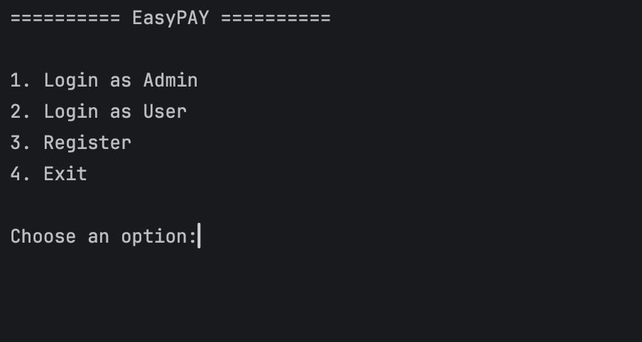
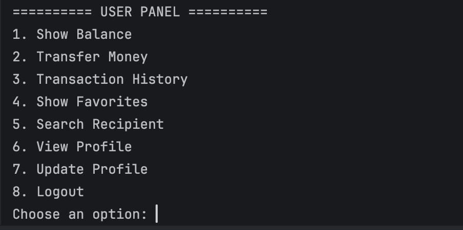
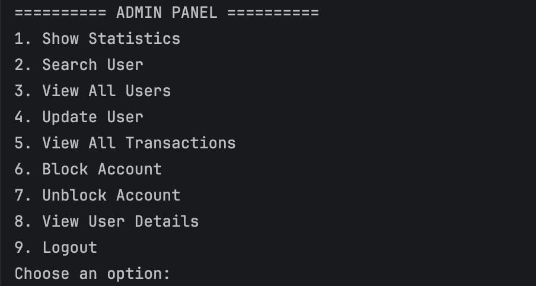

# EasyPay

<div align="center">


### A Java-Based Digital Wallet Simulation

A simple educational project for managing virtual balances, transferring funds between users, and exploring transaction records — with an administration panel for user and transaction management.


</div>

---

## 📌 Project Overview

**EasyPay** is a Java application that simulates the basic features of a digital wallet. Users can manage a virtual balance, transfer virtual money to other users, review transaction history, and manage favorite contacts.

The application also includes an **Admin Panel** for managing user accounts, monitoring transactions, blocking accounts, and viewing application statistics.

EasyPay was developed as a learning project to practice core Java programming concepts, including variables, conditions, switch statements, loops, arrays, methods, strings, and basic input validation.

> ⚠️ **Educational use only:** EasyPay is a simulation. It does not process real payments, connect to banks, or handle real money.

## ✨ Features

### 👤 User Features

- Register and log in to an account.
- View and manage a virtual wallet balance.
- Transfer virtual funds to other users.
- View transaction history.
- Manage favorite contacts.
- Validate user input and handle common errors.

### 🛠️ Admin Features

- View and manage registered users.
- Monitor transactions.
- Block accounts when necessary.
- View application statistics, such as user counts and transaction totals.

## 🖥️ Screenshots

The screenshots below can be added directly to this README using GitHub's Markdown editor.

### Main Menu


Upload your screenshot here by dragging and dropping the image into the GitHub editor.

### User Panel

### Admin Dashboard


## 🧰 Technologies & Concepts

- **Language:** Java
- **IDE:** NetBeans
- **Core Concepts:** Variables, conditions, `switch` statements, loops, arrays, methods, and strings.
- **Validation:** Basic input and data validation.
- **GUI:** Java Swing / JFrame.

## 🚀 Getting Started

### Prerequisites

- Install a compatible Java Development Kit (JDK).
- Use an IDE such as NetBeans, IntelliJ IDEA, or another Java IDE.

### Run the Project

1. Clone the repository:

   ```bash
   git clone https://github.com/MinaPhilip/EasyPay.git
   ```

2. Open the project in your Java IDE.
3. Allow the IDE to load or configure the project.
4. Locate the main class containing `public static void main(String[] args)`.
5. Run the main class.

> The exact run steps may vary depending on the project's folder structure and IDE configuration.

## 📂 Project Structure

```text
EasyPay/
├── assets/
│   └── easypay-logo.jpg
├── src/
│   └── Java source files
├── README.md
└── NetBeans project files
```

The structure above is illustrative. Your actual source files and project folders may differ.

## 🎯 Project Purpose

This project demonstrates introductory Java programming and basic application logic through a digital-wallet scenario.

It provides practical experience with user management, virtual transactions, input validation, arrays, methods, and graphical user interfaces.

EasyPay is an educational simulation, not a production banking or payment system.

## 👨‍💻 Author

**Mina Philip**

- GitHub: [@MinaPhilip](https://github.com/MinaPhilip)

---

<div align="center">

**EasyPay — Simple, clear, and educational.**

</div>